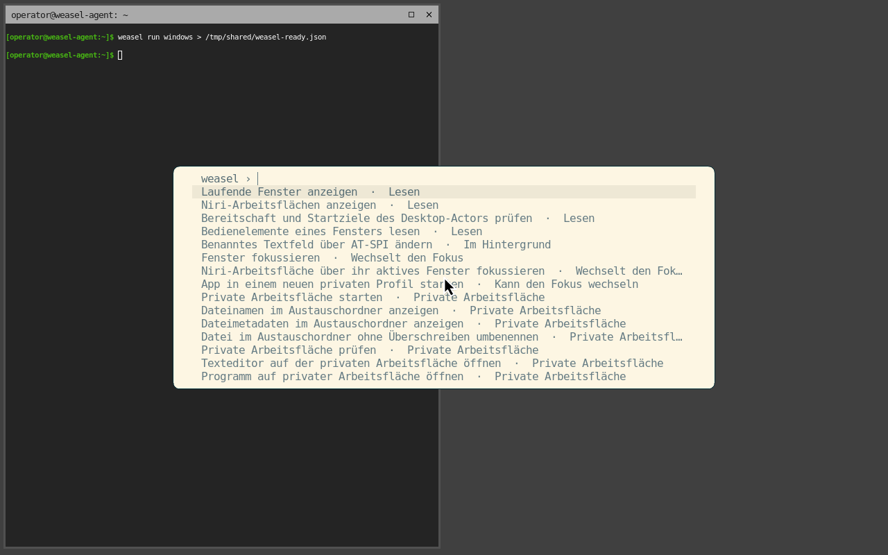

# weasel-agent

Der x86_64-Linux-Gast startet einen Niri-Desktop mit Codex CLI, ChatGPT Desktop für Linux und Crew. Der VM-Benutzer heißt `operator`. Die VM verwendet ihre eigene beschreibbare Disk. Anmeldung bei einem Anbieter erfolgt im gewählten Client.

## VM starten

Im ausgecheckten weasel-os-Repository auf einem grafischen x86_64-Linux-Rechner mit Nix, Flakes und KVM:

```sh
nix run --no-write-lock-file .#weasel-agent
```

Für den Start direkt aus dem Featurezweig:

```sh
nix run 'github:morrowbyte/weasel-os?ref=feature/agent-first-os#weasel-agent'
```

Die QEMU-VM verwendet eine virtuelle Grafikausgabe. Weston stellt dafür einen Monitor mit Software-Rendering bereit, Niri verwaltet die Benutzerfenster. Für einen eigenen NixOS-Rechner lässt sich das exportierte Modul `nixosModules.agent-first` mit dessen vorhandener Hardware-, Benutzer- und Anmeldekonfiguration kombinieren.

Mit **Super+D** startest du Codex CLI, ChatGPT oder Crew in deiner Niri-Sitzung. Beim ersten Start eines Desktop-Clients kann GNOME nach einem Passwort für den neuen Schlüsselbund fragen. Wähle ein eigenes Passwort für diesen Gast und bestätige es im Systemdialog. Anschließend kann der Client seine Oberfläche laden und später die Anbieteranmeldung geschützt speichern. Beim erneuten Entsperren verwendet der Gast dasselbe Schlüsselbund-Passwort.

| Taste | Aktion |
| --- | --- |
| Super+Space | Systemaktion suchen |
| Super+D | Installierte Anwendung starten |
| Super+Umschalt+D | Eine App zur gemeinsamen Nutzung öffnen oder eine laufende private Sitzung wieder anzeigen |
| Super+Return | Terminal öffnen |
| Super+E | Mousepad öffnen |
| Super+F1 | Tastenkürzel anzeigen |
| Super+Bild↑ / Bild↓ | Arbeitsfläche wechseln |
| Alt+Escape | Aktuellen Desktop-Auftrag abbrechen und private Eingaben sperren |
| Strg+Alt+Escape | Die Steuerung des persönlichen Desktops übernehmen |
| Super+Umschalt+A | Den persönlichen Desktop nach Sitzungsstart oder Übernahme für neue Aufträge freigeben |



Nach der Anmeldung gibt Super+Umschalt+A den persönlichen Desktop frei. Die gleiche Aktion ist im Terminal als `weasel resume-desktop` verfügbar. Für eine neue private Aufgabe nach Alt+Escape wähle in der Palette **Private Eingaben für neue Aufträge freigeben**. Zum Kennenlernen des Katalogs genügen zwei Terminalbefehle ohne Modellkonto.

```sh
weasel catalog
weasel run windows
```

Für eine App, in der du und der Agent abwechselnd arbeiten, drücke **Super+Umschalt+D** und tippe den App-Namen. Das neue Fenster zeigt die private Sitzung. Sobald du zu einem anderen Fenster wechselst, kann der Agent mit ihrer angezeigten Sitzungskennung weiterarbeiten. Mit derselben Tastenkombination findest du die laufende Sitzung wieder.

Ein Agent erreicht die gemeinsamen Aktionen über den lokalen MCP-Server `weasel_os`. Für fenstergebundene Beobachtungen und die direkte Steuerung steht `weasel_desktop` bereit. Beide sind in der Systemvorgabe unter `/etc/codex/config.toml` eingetragen. Maßgeblich für die Bedienung ist das lokale Backend in der laufenden Sitzung. Eine Cloud-Sitzung oder ein entfernter Crew-Provider läuft auf einem anderen Rechner.

## Im Hintergrund ein Dokument bearbeiten

Für eine bereits geöffnete Anwendung kann der Actor ein von der App bereitgestelltes Textfeld anhand der Fenster-ID lesen, gezielt ändern und erneut lesen. Fenster, Arbeitsfläche und Fokusereignisse dienen zur Prüfung der Wirkung. Die Möglichkeiten eines vorhandenen Fensters hängen von der App und den angebotenen Wayland- und Accessibility-Schnittstellen ab.

Eine private Sitzung kann installierte grafische Programme mit eigenem Fokus, Home, Bus und eigener Zwischenablage öffnen. Native Wayland-Apps verbinden sich direkt, X11-Apps über den privaten Xwayland-Server. Der folgende Aufruf öffnet Mousepad für eine neue Aufgabe.

```sh
weasel-workspace --name bericht start --exchange "$HOME/bericht-austausch"
touch "$HOME/bericht-austausch/notiz.txt"
weasel run private_open '{"name":"bericht","program":"mousepad","argv":["--disable-server","/exchange/notiz.txt"],"wait_window":"org.xfce.mousepad"}'
weasel-workspace --name bericht status
```

Das Statusresultat nennt Titel und App-ID. Nach Prüfung des Zielfensters lassen sich Text und Speichern als Folge ausführen:

```sh
printf '%s\n' '[["text","Notiz aus der privaten Sitzung"],["key","Ctrl+s"]]' |
  weasel-workspace --name bericht batch notiz-speichern
cat "$HOME/bericht-austausch/notiz.txt"
weasel-workspace --name bericht stop
```

Mit `weasel-workspace --name bericht view` lässt sich eine laufende Sitzung als Niri-Fenster öffnen. Solange dieses Fenster den Fokus hat, bedienst du den privaten Desktop selbst. Wechselst du zu einem anderen Fenster, kann der Agent an derselben App weiterarbeiten. Schließt du das Ansichtsfenster, bleibt die private App bis `stop` geöffnet.

Ein neues Austauschverzeichnis beginnt leer. Programme mit Netzzugriff benötigen bei Sitzungsstart `--network`. Einmalaufträge erhalten eine eindeutige ID. Nach einem Abbruch zeigt ein frischer Blick in Datei oder Fenster, welche Schritte bereits wirksam waren.

Für Dateioperationen im freigegebenen Austauschordner stehen `private_exchange_list`, `private_exchange_lstat` und `private_exchange_rename_noreplace` direkt im Katalog. So kann ein Agent eine Datei umbenennen und den neuen Namen im selben `weasel compose` prüfen. Zum pixelgenauen Arbeiten in Programmen stehen unter anderem Screenshot, Klick, Ziehen und Scrollen bereit. In einem Editor mit Kopierfunktion kann der Agent Text markieren, mit Strg+C kopieren und mit `private_clipboard_read` samt Zeilenumbrüchen zurücklesen. [Beispiele für Dateioperationen](../../packages/agent-desktop/EXCHANGE.md)

Für Dokumente und App-Einstellungen, die einen Gastneustart überdauern sollen, starte die Arbeitsfläche mit `weasel-workspace --name bericht start --persistent`. Öffne sie später mit demselben Befehl. Die Programme erhalten dann wieder ihr eigenes Home. Austauschordner und Netzwerk wählst du bei jedem Start separat.

## Reproduzierbare Abnahme

```sh
nix build -L --no-write-lock-file .#checks.x86_64-linux.agent-first-desktop
```

Der Test bootet einen Wegwerfgast, erfasst Niris Fokusereignisse und prüft ein gespeichertes Mousepad-Dokument sowie den gleichzeitig eingegebenen Vordergrundtext. Er startet Codex CLI, ChatGPT Desktop und Crew über das Anwendungsmenü. Ihre drei ausgelieferten lokalen Codex-Backends lesen mit der System-MCP-Konfiguration die Fenster und ergänzen nacheinander dieselbe Datei in Mousepad. Der Test vergleicht die Dateibytes nach jedem Speichern. Die Modellbenchmarks verwenden einen eigenen frischen Gast pro Versuch. [Aufgaben und Messverfahren](../../tests/agent-bench/README.md) · [Ergebnisse und Fehlversuche](../../tests/agent-bench/RESULTS.md)

[Gemeinsamer Katalog](../../packages/agent-desktop/README.md) · [Private Anwendungen](../../packages/agent-desktop/PRIVATE-APPS.md) · [Workspace-Befehle und Datenübergabe](../../packages/agent-workspace/README.md) · [Unterstützte Clientpakete](../../packages/agent-clients/README.md)
